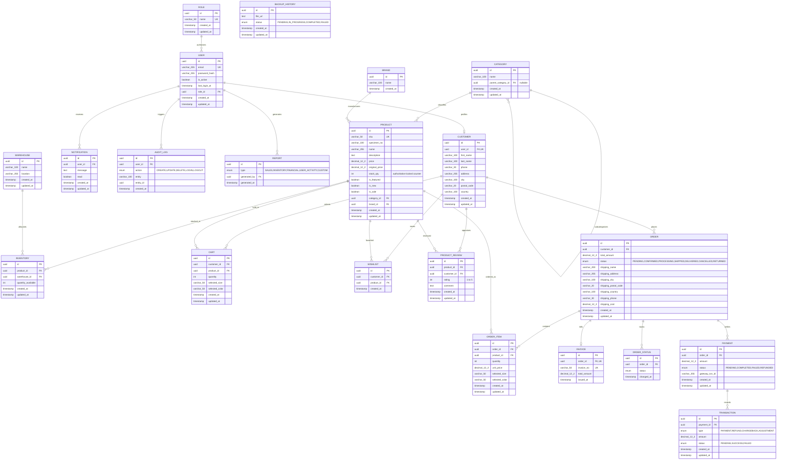

# Entity-Relationship (ER) Diagram
## E-Commerce Order Management Platform

> **Relational Database:** PostgreSQL 16 (Neon Serverless)  
> **ORM Engine:** Prisma ORM  
> **Total Entities:** 16 Relational Tables  
> **Primary Key Standard:** UUIDv4 (`@db.Uuid`)  
> **Table Mapping:** snake_case physical table names (`@@map("...")`)  

---

## 1. Visual Entity-Relationship Diagram (Mermaid)

---

## 2. Relational Schema Integrity & Constraint Specifications

### 2.1 Foreign Key Referential Constraints
1. `users.role_id` $\longrightarrow$ `roles.id` (`ON DELETE RESTRICT`)
2. `customers.user_id` $\longrightarrow$ `users.id` (`ON DELETE CASCADE`)
3. `categories.parent_category_id` $\longrightarrow$ `categories.id` (`ON DELETE RESTRICT`)
4. `products.category_id` $\longrightarrow$ `categories.id` (`ON DELETE RESTRICT`)
5. `products.brand_id` $\longrightarrow$ `brands.id` (`ON DELETE RESTRICT`)
6. `inventories.product_id` $\longrightarrow$ `products.id` (`ON DELETE CASCADE`)
7. `inventories.warehouse_id` $\longrightarrow$ `warehouses.id` (`ON DELETE CASCADE`)
8. `orders.customer_id` $\longrightarrow$ `customers.id` (`ON DELETE RESTRICT`)
9. `order_items.order_id` $\longrightarrow$ `orders.id` (`ON DELETE CASCADE`)
10. `order_items.product_id` $\longrightarrow$ `products.id` (`ON DELETE RESTRICT`)
11. `order_statuses.order_id` $\longrightarrow$ `orders.id` (`ON DELETE CASCADE`)
12. `invoices.order_id` $\longrightarrow$ `orders.id` (`ON DELETE CASCADE`)
13. `payments.order_id` $\longrightarrow$ `orders.id` (`ON DELETE CASCADE`)
14. `transactions.payment_id` $\longrightarrow$ `payments.id` (`ON DELETE CASCADE`)
15. `notifications.user_id` $\longrightarrow$ `users.id` (`ON DELETE CASCADE`)
16. `audit_logs.user_id` $\longrightarrow$ `users.id` (`ON DELETE CASCADE`)

### 2.2 Compound Unique Constraints (Deduplication & Integrity)
- `inventories`: `@@unique([productId, warehouseId])` — Guarantees exactly one inventory record per product per warehouse.
- `carts`: `@@unique([customerId, productId, selectedSize, selectedColor])` — Prevents duplicate cart rows for identical product variants.
- `wishlists`: `@@unique([customerId, productId])` — Prevents multiple wishlist entries for the same product.
- `product_reviews`: `@@unique([productId, customerId])` — Enforces academic constraint of one review per customer per product.

---

## 3. Database Normalization Analysis
- **1NF (First Normal Form):** Every table possesses a primary key (`UUID`), and all attributes are atomic values (with JSON columns reserved strictly for UI metadata).
- **2NF (Second Normal Form):** All non-key attributes are fully functionally dependent on the entire primary key. No partial dependencies exist.
- **3NF (Third Normal Form):** Non-key attributes depend solely on the primary key with zero transitive dependencies (e.g., customer shipping address resides strictly on `Customer`, referenced via foreign key from `Order`).
