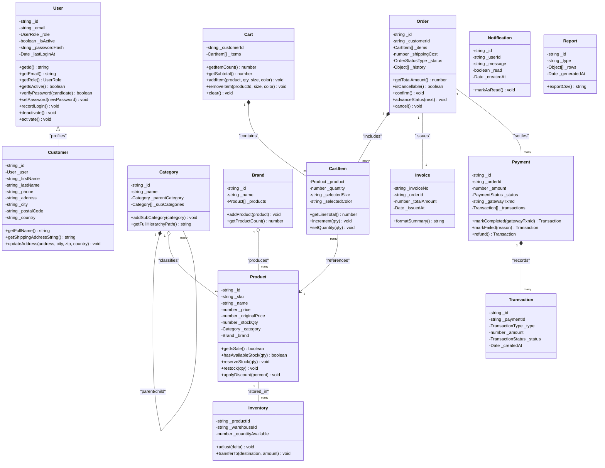
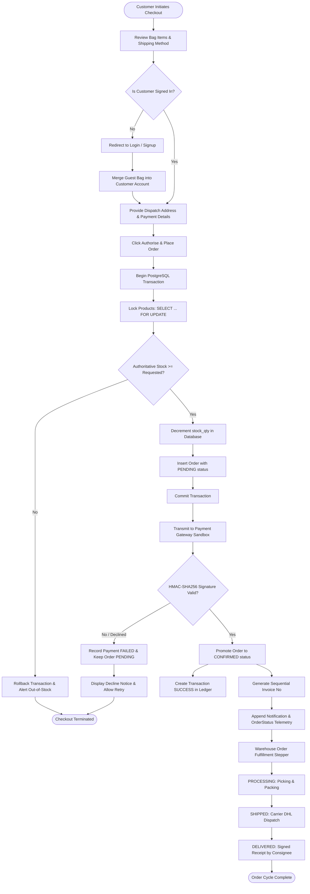
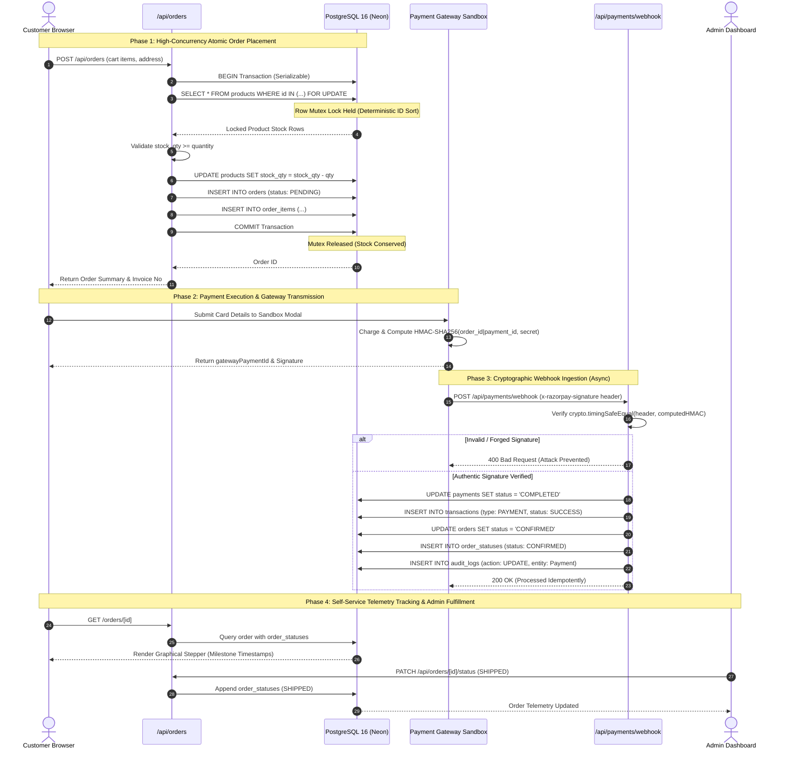

# UML Diagrams Architecture Specification
## E-Commerce Order Management Platform

> **Standard:** Unified Modeling Language (UML 2.5)  
> **Diagram Format:** Mermaid Syntactically Valid Code Blocks  
> **Contents:** Use Case Diagram, Class Diagram, Activity Diagram, Sequence Diagram  

---

## 1. Use Case Diagram

### 1.1 Actors
1. **Customer:** End-user purchasing archival fashion items.
2. **Administrator:** System manager overseeing catalog, inventory, customers, order lifecycles, and disaster recovery.
3. **Vendor:** Merchant managing catalog allocations and inventory for their assigned brand.
4. **Payment Gateway:** External third-party payment settlement provider (Razorpay / Stripe).

### 1.2 Visual Diagram (Mermaid)

```mermaid
flowchart TB
    subgraph Actors
        C((Customer))
        A((Administrator))
        V((Vendor))
        PG((Payment Gateway))
    end

    subgraph "Storefront & Account Boundary"
        UC_Reg[Register Account]
        UC_Auth[Sign In & Rotate Password]
        UC_Browse[Browse & Search Products]
        UC_Cart[Manage Cart & Variants]
        UC_Wishlist[Manage Wishlist]
        UC_Review[Submit Rating & Appraisal]
        UC_Profile[Update Shipping Profile]
        UC_Track[Track Order Timeline]
    end

    subgraph "Order & Inventory Boundary"
        UC_Checkout[Place Order]
        UC_Lock[Lock Stock Row Mutex]
        UC_Cancel[Cancel Order]
        UC_Invoice[Download / Print Invoice]
        UC_Transfer[Transfer Inter-Warehouse Stock]
        UC_StockAdj[Direct Stock Adjustment]
    end

    subgraph "Payment & Admin Boundary"
        UC_Pay[Authorise Gateway Payment]
        UC_Webhook[Ingest Cryptographic Webhook]
        UC_Ledger[Balance Financial Ledger]
        UC_CustDir[Manage Customer Accounts]
        UC_ProdCRUD[Product & Category CRUD]
        UC_Reports[View Analytics & Export CSV]
        UC_Backup[Trigger & Restore Backups]
        UC_VendorPortal[Manage Brand Allocations]
    end

    %% Customer Associations
    C --> UC_Reg
    C --> UC_Auth
    C --> UC_Browse
    C --> UC_Cart
    C --> UC_Wishlist
    C --> UC_Review
    C --> UC_Profile
    C --> UC_Track
    C --> UC_Checkout
    C --> UC_Cancel
    C --> UC_Invoice

    %% Admin Associations
    A --> UC_Auth
    A --> UC_CustDir
    A --> UC_ProdCRUD
    A --> UC_Transfer
    A --> UC_StockAdj
    A --> UC_Reports
    A --> UC_Backup

    %% Vendor Associations
    V --> UC_Auth
    V --> UC_VendorPortal

    %% Includes & Extends
    UC_Checkout -.->|<<include>>| UC_Lock
    UC_Checkout -.->|<<include>>| UC_Pay
    UC_Pay -.->|<<include>>| UC_Ledger
    UC_Pay -.->|<<interacts>>| PG
    PG -.->|<<dispatches>>| UC_Webhook
    UC_Webhook -.->|<<include>>| UC_Ledger
    UC_Cancel -.->|<<extend>>| UC_Track
```

---

## 2. Structural UML Class Diagram

The Class Diagram reflects the object-oriented domain layer implemented in `src/domain/`:

---

## 3. Order Processing & Fulfillment Activity Diagram

---

## 4. Concurrency & Webhook Execution Sequence Diagram

